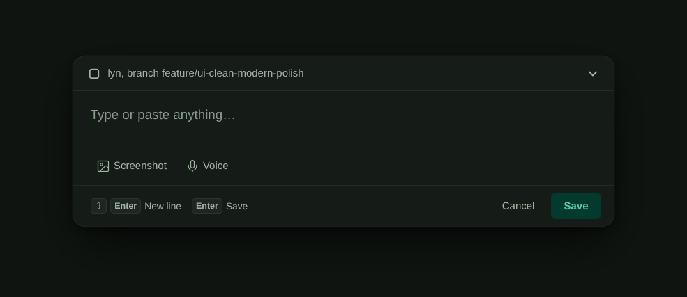
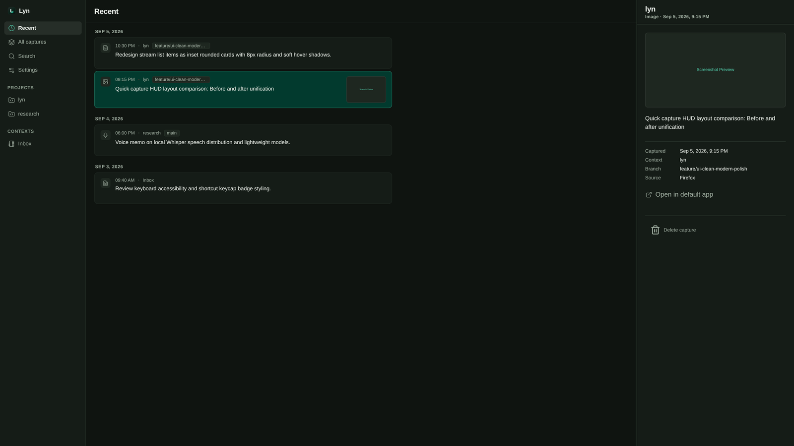

# Lyn

<p align="center">
  
</p>

<p align="center">
  <strong>Lyn</strong><br />
  A fast, local-first desktop working-memory companion for developers and focused computer work.
</p>

<p align="center">
  <code>local-first</code> · <code>desktop</code> · <code>tauri</code> · <code>rust</code> · <code>svelte</code> · <code>sqlite</code>
</p>

```text
global shortcut → type, paste, or record → Enter → return to work
```

Lyn captures titleless text notes, screenshots, and voice notes, associates them with the project and Git branch you were just in, and keeps them in a chronological Library with local search. Everything stays on your machine.

<p align="center">
  
</p>

<p align="center">
  
</p>

## Why Lyn

Traditional note apps interrupt flow: open a notebook, name a page, pick a folder. Lyn is the opposite—an always-available capture surface that preserves the thought **with** the context it came from, then gets out of the way.

- **Local-first:** core capture never depends on accounts, cloud APIs, or remote AI.
- **Context-aware:** optional VS Code, Cursor, Browser, Kitty, and shell providers bind to the pre-popup window; you can always choose manually.
- **Save first:** enrichment (optional local speech captions) never blocks a successful save.

## Download / install

Installers are published on **[GitHub Releases](https://github.com/mibienpanjoe/lyn/releases)** (manual download; no in-app auto-updater).

| Artifact | Platform | Notes |
|---|---|---|
| `.deb` | Linux (Debian/Ubuntu-family, x86_64) | Preferred on Pop!_OS / Ubuntu |
| `.tar.gz` | Linux x86_64 | Portable binary + LICENSE + README |
| `.exe` (NSIS) | Windows x86_64 | **Experimental** until owner smoke-tested |

**Signing:** v1 artifacts are **unsigned**. Windows may show SmartScreen / “unknown publisher”; that is expected until Authenticode is added later.

### Support matrix

| Target | Status |
|---|---|
| Pop!_OS 22.04 LTS / Ubuntu-compatible, x86_64, **X11** | Verified baseline (dev); package install pending owner smoke |
| Windows x86_64 | Expansion — buildable; claim support only after `.exe` smoke |
| macOS | Deferred |
| Wayland | Deferred |

Toolchain for from-source builds: Node 24.12.0, pnpm 10.28.0, Rust 1.96.1, plus [Tauri 2 prerequisites](https://v2.tauri.app/start/prerequisites/) for the host OS.

### From source (development)

```bash
git clone https://github.com/mibienpanjoe/lyn.git
cd lyn
pnpm install
pnpm tauri dev
```

Default shortcut: `Ctrl+Shift+Space` opens quick capture. The Library window is the main shell.

### Build release packages

```bash
# Linux host → .deb under src-tauri/target/release/bundle/deb/
#            → .tar.gz under dist-packages/
pnpm package:linux

# Windows host → NSIS .exe under src-tauri/target/release/bundle/nsis/
pnpm package:windows
```

Upload those assets to a GitHub Release, or push a `v*` tag / run the **release** workflow so CI builds Linux + Windows and attaches them automatically.

Other useful commands (full list in [AGENTS.md](AGENTS.md)):

```bash
pnpm test
cargo test --manifest-path src-tauri/Cargo.toml
```

## Features

| Area | What you get |
|---|---|
| Quick capture | Text, screenshot paste, voice note; Enter saves and dismisses |
| Context | Live sessions + saved contexts; ambiguity never guesses |
| Library | Chronology by project, detail inspection, capture deletion, play/open media by opaque ID |
| Search | Bounded local FTS over note bodies and user-visible captions |
| Settings | Shortcut, theme, provider tie-break order, 1-click integrations installer, optional local speech model, installed app version |

## Optional local speech

Settings can install a **CPU-only** whisper.cpp engine and multilingual Whisper `base` model after an explicit user action. Model install is the only network-capable path; capture and Library work offline without it. See [`docs/09_local_speech_distribution_decision.md`](docs/09_local_speech_distribution_decision.md).

## Context providers (Linux X11)

Providers are optional. You can configure all of them with **1-click directly in Lyn Settings (under Integrations & Context Providers)** with zero terminal commands, or manually using the guides below:

- **VS Code & Cursor:** [`integrations/vscode/`](integrations/vscode/README.md) — 1-click install in Lyn Settings, or `pnpm provider:vscode:package` → install `/tmp/lyn-context-provider.vsix` via `code` or `cursor`
- **Browser (Chrome, Chromium, Brave, Edge, Firefox):** [`integrations/browser/`](integrations/browser/README.md) — 1-click register in Lyn Settings, or `pnpm provider:browser:install` → load unpacked extension in browser
- **Kitty:** [`integrations/kitty/`](integrations/kitty/README.md) — 1-click configure in Lyn Settings, or watcher path in `kitty.conf`
- **Shell helper:** [`integrations/shell/`](integrations/shell/README.md) — 1-click add to `~/.bashrc` in Lyn Settings. Opening Lyn refreshes the helper automatically; start a new terminal after an update.

Providers never send terminal output, editor buffers, or agent chat into Lyn.

### Native GNOME prototype (development only)

`pnpm provider:gnome:test` compiles an experimental GTK3/VTE module and the current Rust test harness. It tests real GNOME Terminal windows, tabs, TUI identity, and native module-to-Rust broker exchanges on private Xvfb/D-Bus. It does not install anything or enable native automatic context in Lyn yet.

`pnpm provider:gnome:desktop:test` exercises the real Tauri popup, global shortcut, native context, SQLite save, rendered Library and focus return in the same isolated environment. It additionally requires Openbox and system Python GI AT-SPI/GDK. Both native test commands use `/usr/bin/python3` so a Conda environment cannot replace the GI-enabled interpreter. Alongside the explicit-readiness scenario, it creates two windows concurrently and captures once from each without waiting for native readiness. Use `pnpm provider:gnome:desktop:test --startup-pairs=20` for twenty independent startup pairs; each fixture keeps its private 60-second lifetime. Reconnect and installed-package acceptance remain separate checks. Screenshots are kept under local, ignored `tasks/`.

`pnpm provider:gnome:desktop:test --warm-alternations=100` adds a continuous series on the same two windows, then the same two tabs with distinct project directories. Each series saves an initial note followed by 100 alternating captures, checks every SQLite result and focus return, and inspects the latest five Library rows. Tab creation uses a synthetic command in the fixture's private settings, never the user's shell profiles. The per-fixture 60-second limit still applies.

`pnpm provider:gnome:desktop:test --tab-relocation` adds five captures across two tabs, detaches one into a new window and verifies source/PTY/process continuity, changed window/topology and captures from both resulting windows.

Requires the Rust toolchain above, Linux with pidfd support, GTK3/VTE development headers, GCC/pkg-config, Xvfb with X-Resource 1.2/xauth, GNOME Terminal, xdotool/xprop, Python with pidfd APIs and GI GTK3, and htop. Developers can set `LYN_GNOME_SDK_ROOT` to a local directory with packages extracted beneath `root/`; the test never installs system packages or modifies terminal profiles outside its temporary environment.

## Documentation

- [Project overview](docs/project_overview.md)
- [Requirements](docs/01_requirements_prd.md) · [SRS](docs/02_requirements_srs.md)
- [Architecture](docs/05_architecture.md) · [IPC](docs/06_api_specification.md)
- [Visual identity](docs/07_visual_identity.md)
- [HEX (Anomaly) research note](docs/research_hex_anomaly.md)
- [Contributor guidelines](AGENTS.md)

## License

SPDX: [MIT](LICENSE)

Optional local speech downloads (whisper.cpp / Whisper `base`) are also MIT-licensed upstream; release notes must retain their attribution when those components are documented.
